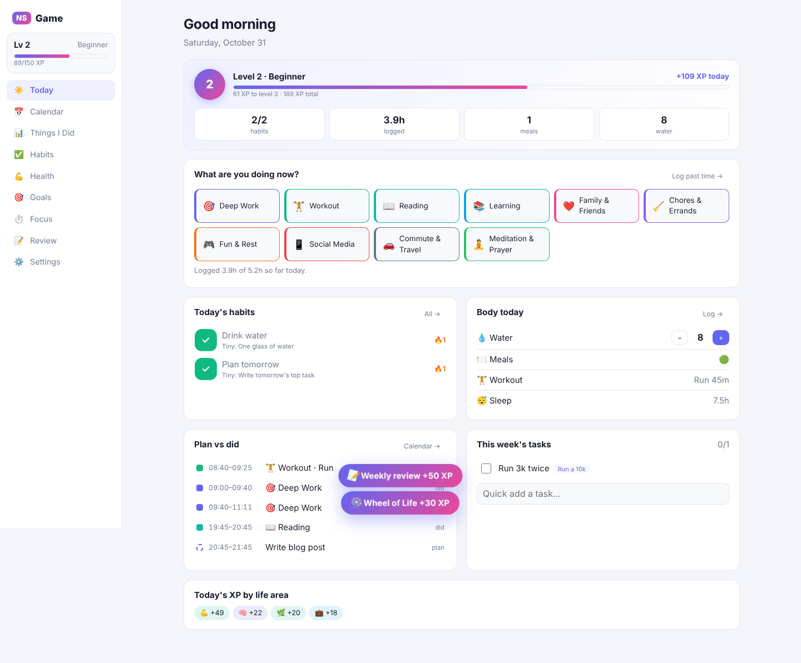
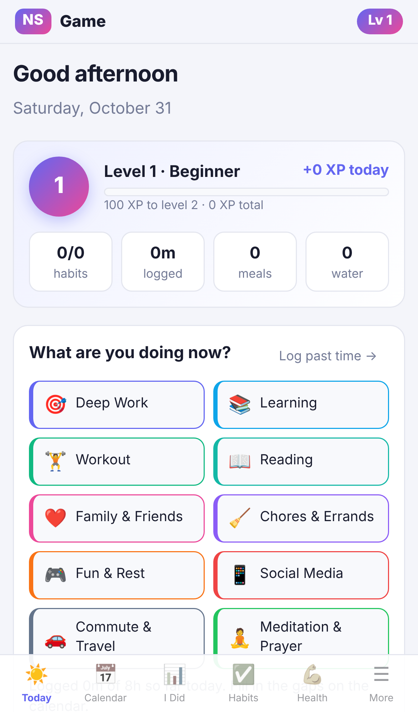
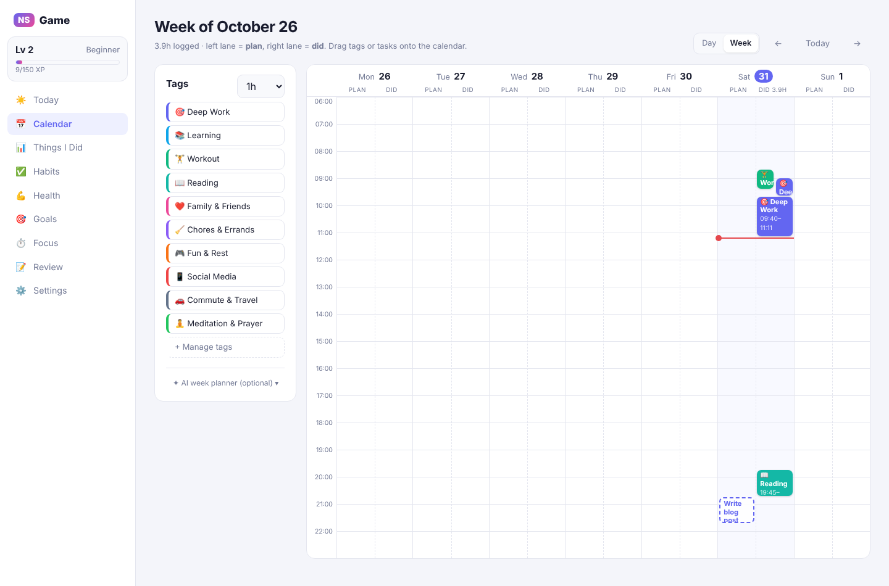
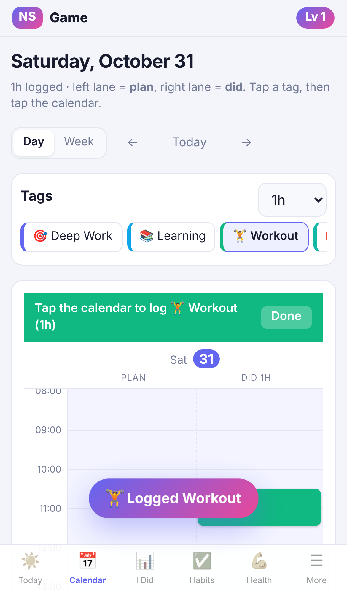

# 🎮 NS Game

**Level up your life.** A free personal app for your PC and iPhone that records what you do with your time, your habits, your body and your goals, and turns it into XP, levels and stats.

| PC | iPhone |
|---|---|
|  |  |
|  |  |

## What's inside

| Section | What it does |
|---|---|
| ☀️ **Today** | Your level and XP, one-tap tracking ("what are you doing now?"), today's habits, water, meals, workout and sleep at a glance, plan vs did, and this week's tasks. |
| 📅 **Calendar** | The full 24 hours, in day and week view. Each day has a **Plan** lane (left) and a **Did** lane (right). On PC, drag a tag onto the calendar to record "I did this at this time". On iPhone, tap a tag, then tap the time. Drag blocks to move them and drag their bottom edge to resize. |
| 📊 **Things I Did** | Every tag's total time for **day, week, month, year and all time**, with change vs the previous period, a chart over time, top **projects**, and a breakdown by life area. **Search** any project, note or tag (for example "Zen Media House") to see its hours today, this week, month, year and all time, a 12-month chart, and every entry. Tap a tag for its details, including a by-project breakdown. Every entry can be edited. |
| 🗂️ **Projects** | Each log, timer and focus session can have a project or client (for example Deep Work → *Zen Media House* → "video editing"). Projects you've used before are suggested as you type. |
| ✅ **Habits** | Identity ("I am a reader"), anchor ("After dinner…"), a tiny 2-minute version, and the days it applies. Habits can be **ticked automatically by your data**: time logged on a tag, focus minutes, a workout, meals, healthy meals, water, sleep or a weigh-in. Streaks follow "never miss twice", there's a 7-day grid and a 12-month heatmap, and every tick gets a celebration. |
| 💪 **Health** | Daily check-in (sleep, sleep quality, weight, water in litres, steps, energy, mood, notes), workouts with exercises, sets, reps and weights, meals rated 🟢🟡🔴 with optional protein, and trends for weight, sleep, workouts per week and eating quality. Workouts also show up in your calendar and in Things I Did. |
| 🗺️ **Quests** | Goals as a game. Each quest is a winding road from 🏁 to a boss 🐉, with checkpoints, optional rewards and your hero moving along it. Progress can be a **monthly or weekly target** (e.g. $10,000/month, which resets each month and keeps a history), a **running total**, a **latest value** (e.g. weight 80 → 72 kg) or **completed tasks**. Quests show the daily target, your pace, a projected finish date and a log streak. Checkpoints give +50 XP and defeating the boss gives +200. |
| 🌌 **Mind Atlas** | The polymath section. **Domains** (your fields) level up through mastery tiers from the hours on their tags; the **Constellation** shows them as stars, with lines where your ideas connect fields. There's also a **Commonplace Book** for ideas with cross-links, Feynman's **12 Favorite Problems**, a **Library** learning queue, and a daily **cross-pollination** prompt. |
| 🪶 **Journal** | Daily reflection: *What did I learn? What am I grateful for? Thoughts.* Includes a philosophy quote of the day, a streak and search across past entries. |
| 🏆 **Trophies** | 28 milestone achievements from bronze to mythic (Centurion, Stoic Scribe, Polymath…), plus a path of titles from Novice to Philosopher-King. |
| ⏱️ **Focus** | Focus timer (25/50/90 min) tied to a tag and a task. Sessions log themselves to your time record and count toward focus habits. A timer started on your PC also shows on your iPhone. |
| 📝 **Review** | Weekly stats and reflection, the monthly **Wheel of Life** self-rating (radar chart vs last month), and your **character stats**: a level for each of the 8 life areas. |
| ⚙️ **Settings** | Sync, install guide, backup export and import, and how XP works. |

Everything is connected: one entry in your time log counts toward Things I Did, your habits, your XP and your life-area stats.

**Cost: free.** It's hosted on GitHub Pages (free) and syncs through the Firebase Spark plan (free, no credit card). The ✦ AI buttons are optional and are the only thing that costs money. You never need them.

## Get started

👉 **Follow [SETUP.md](SETUP.md)** (about 15 minutes, once). It puts the app online, connects sync, and installs it on your iPhone.

To try it on your computer first (needs [Node.js](https://nodejs.org) 20+):

```bash
npm install
npm run dev
```

Then open http://localhost:5173.

## Why it's designed this way

Each feature is based on research and expert advice. See [RESEARCH.md](RESEARCH.md).

## How your data is stored

- **On your device first.** The app works offline, and every change is saved instantly to the device's storage (IndexedDB). It asks the browser to keep that storage permanently.
- **Synced to your own Firebase account** when you sign in. Each change uploads in the background, and your other device receives it within seconds. If both devices change the same item, the newest change wins. Offline edits upload when you're back online.
- **Backups:** Settings → Export backup gives you a JSON file of everything.

## Code map

| File | Purpose |
|---|---|
| `src/types.ts` | Data model (tags, entries, habits, health, goals…) |
| `src/store.tsx` | Local-first storage and change tracking |
| `src/sync.tsx` | Firebase sync (email login, incremental pull, batched push) |
| `src/game.ts` | Habit status, never-miss-twice streaks, XP, levels |
| `src/pages/*` | One file per screen |
| `public/sw.js` | Offline support |
| `firestore.rules` | Security rules: only you can read or write your data |
